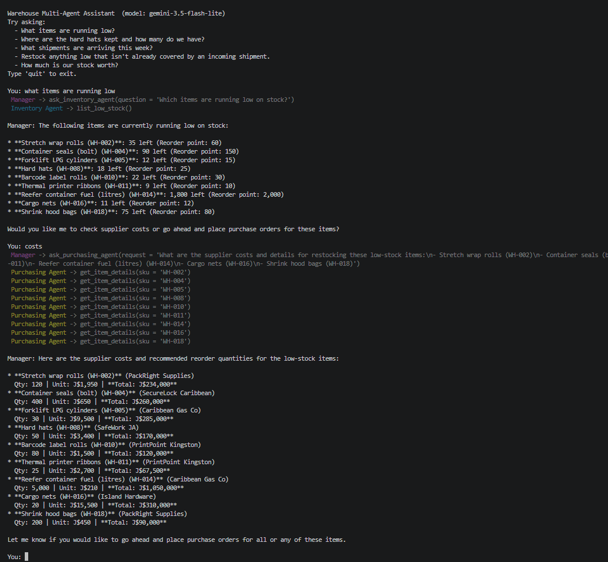

# MULTI-AGENT WAREHOUSE ASSISTANT 
A multi-agent system that tracks warehouse activities such as stock levels, quantity, and reorder status. It uses Google Gemini to communicate with each agent and provides the user with feedback based on their questions. 



## How It Works
- The user asks a question in plain English
- A **Manager agent** decides which specialist agent is equipped to handle it
- The **Inventory agent** handles stock levels, item locations and shipments; the **Purchasing agent** handles suppliers and purchase orders
- Each agent calls the relevant Python function (tool) to get real data, instead of guessing
- The Manager combines the answers and responds to the user

**Guardrails:** only the Purchasing agent can create orders, it only does so when the user asks, and any order over J$500,000 is blocked for human approval.


## Setup

1. Get a free API key from [Google AI Studio](https://aistudio.google.com/apikey)
2. Install the requirements and set your key:

```
pip install -r requirements.txt
setx GEMINI_API_KEY "your_key_here"
```

3. Open a new terminal and run:

```
python main.py
```

## Example Questions

- What items are running low?
- Where are the hard hats kept?
- How much is our stock worth?
- Restock anything low that isn't covered by an incoming shipment.
- Order 12 forklift tyres (shows the spending guardrail)

## What I Learned / Next Steps

- I learned how function calling lets an AI use real data; Gemini decides which Python function to call, my code runs it and the results goes back to the model
- A bug I fixed: Fixed a "duplicate functon declaration" erro from Gemini by using @functools.wraps so each tool kept its own name
- Next: I will add a Receiving agent and replace the CSV files with a database

